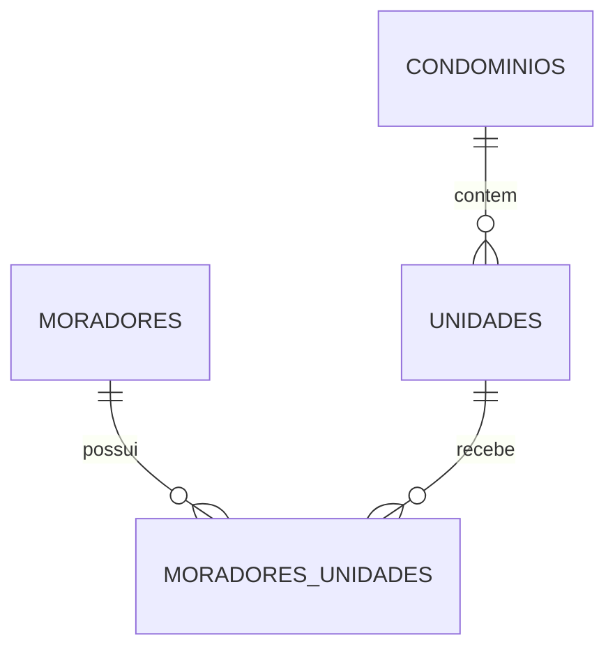

# Modelo de dados do SíndicoDigital

O modelo residencial usa PostgreSQL. A [migration inicial](../database/migrations/001_create_residential_schema.sql) define as tabelas e as restrições abaixo.

## Tabelas e campos

Todos os campos abaixo são obrigatórios. Os campos `id` são gerados pelo PostgreSQL com `GENERATED ALWAYS AS IDENTITY`.

### `condominios`

| Campo | Tipo | Chave ou restrição | Descrição |
|---|---|---|---|
| `id` | `bigint` | Chave primária | Identificador do condomínio |
| `codigo` | `text` | `UNIQUE` | Código do condomínio |
| `nome` | `text` | | Nome do condomínio |

### `unidades`

| Campo | Tipo | Chave ou restrição | Descrição |
|---|---|---|---|
| `id` | `bigint` | Chave primária | Identificador da unidade |
| `condominio_id` | `bigint` | Chave estrangeira para `condominios.id` | Condomínio ao qual a unidade pertence |
| `bloco` | `text` | | Identificação do bloco |
| `numero` | `text` | | Identificação da unidade no bloco |

A combinação `(condominio_id, bloco, numero)` é única. O mesmo número pode aparecer em blocos ou condomínios diferentes.

### `moradores`

| Campo | Tipo | Chave ou restrição | Descrição |
|---|---|---|---|
| `id` | `bigint` | Chave primária | Identificador do morador |
| `nome` | `text` | | Nome do morador |
| `email` | `text` | `UNIQUE` | E-mail do morador |

### `moradores_unidades`

| Campo | Tipo | Chave ou restrição | Descrição |
|---|---|---|---|
| `morador_id` | `bigint` | Parte da chave primária e chave estrangeira para `moradores.id` | Morador vinculado |
| `unidade_id` | `bigint` | Parte da chave primária e chave estrangeira para `unidades.id` | Unidade vinculada |

A chave primária composta `(morador_id, unidade_id)` garante um único vínculo por par. Um índice em `unidade_id` facilita a consulta dos moradores de uma unidade.

## Relacionamentos

| Relacionamento | Cardinalidade | Regra |
|---|---|---|
| Condomínio e unidade | 1:N | Cada unidade pertence a exatamente um condomínio. Um condomínio pode ter zero ou mais unidades. |
| Morador e vínculo | 1:N | Cada vínculo aponta para exatamente um morador. Um morador pode ter zero ou mais vínculos. |
| Unidade e vínculo | 1:N | Cada vínculo aponta para exatamente uma unidade. Uma unidade pode ter zero ou mais vínculos. |
| Morador e unidade | N:N | Moradores e unidades se associam pela tabela `moradores_unidades`. |

As chaves estrangeiras usam a ação padrão `NO ACTION` para exclusões e atualizações. Para excluir um registro referenciado, é preciso resolver as referências antes.
